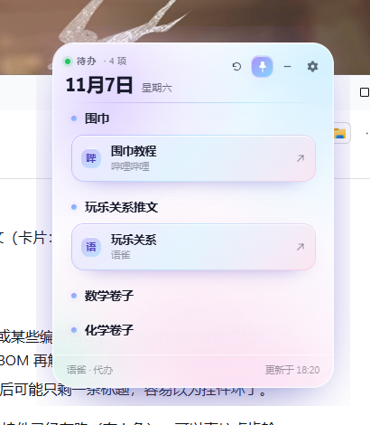
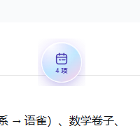

# 桌面待办挂件 · Yuque Todo Widget

一个常驻 Windows 桌面的小挂件：显示今天的日期，并把一篇公开的语雀文档里的待办事项竖排展示；事项下面的链接自动变成卡片，点一下用系统默认浏览器打开。



## 特性

- **今日日期**：公历日期 + 星期，跟随系统浅色 / 深色自动切换主题
- **自动同步**：每 5 分钟重新抓取一次语雀文档；也可以点 ⟳ 立刻刷新
- **事项解析**：文档里的一级标题，或者纯序号（`1`、`1.`、`（2）`、`①`）都当作事项分隔符，取它下面第一段文字作为事项名
- **链接卡片**：事项下面附的链接会渲染成卡片，标题优先用链接自己的文字（比如语雀嵌入卡片的标题），没有就用站点名（哔哩哔哩 / 语雀 / GitHub …）
- **点击即开**：点卡片调用系统默认浏览器打开，不会在挂件里内嵌网页
- **置顶开关**：默认不置顶（只在桌面普通显示），点 📌 才会盖在所有窗口最前面
- **收进托盘**：「−」把窗口藏起来，屏幕上留一枚可以拖动的小圆点（显示事项条数），点圆点恢复
- **点日期区域**：收起成只剩一行标题，再点展开
- **设置**：齿轮里改要抓取的语雀链接，存本地配置，保存后立即重新抓取
- **外观**：柔焦虹彩玻璃 —— 半透明几何面板 + 弥散光斑 + 细渐变描边

| 深色模式 | 收进托盘的小圆点 |
| --- | --- |
|  |  |


## 运行

需要 Node.js 18+。

```bash
npm install
npm start
```

如果启动后看不到窗口（部分机器上 Chromium 的沙箱起不来，进程会静默退出），改用：

```bash
npm run start:nosandbox
```

开发和测试用的是 Electron 44；代码只用到了 `BrowserWindow` / `Tray` / `ipcMain` 这些稳定 API，Electron 30 以上应该都能跑。

## 配置

点右上角齿轮 → 填入你的语雀文档链接（**必须是公开可访问的文档**）→ 保存。

配置存在 Electron 的 `userData` 目录（`npm start` 时一般是 `%APPDATA%\yuque-todo-widget\window.json`；如果按免安装方式把 app 目录塞进 Electron runtime，则会落在 exe 同级的 `data\` 目录），里面有窗口位置、置顶状态、抓取链接等。

> 仓库里代码的默认链接是作者自己的公开文档，只是当示例用，换成你自己的即可。

## 实现说明

```
main.js            主进程：无边框透明窗口、常驻桌面、置顶、托盘、小圆点、配置、定时刷新
preload.js         contextBridge 暴露给页面的最小 API
index.html         面板骨架
renderer.js        界面逻辑（纯 DOM，无框架）
styles.css         柔焦虹彩玻璃样式 + 深色模式
scraper.mjs        抓取并解析语雀文档（零依赖）
bubble.html        收进托盘后的小圆点（可拖动，点一下恢复）
bubble-preload.js  小圆点的 preload
icon.png/.ico      图标
```

抓取流程（`scraper.mjs`）：

1. 请求文档页面 HTML，正则取出 `window.appData = JSON.parse(decodeURIComponent("…"))`，拿到 `doc.id` / `doc.book_id`；
2. 带 `referer` 请求 `https://<host>/api/docs/<id>?book_id=<book_id>`，返回的 `data.content` 是语雀的 lake HTML；
3. 用一个极简的标签分词器切出顶层块，按「序号 / 一级标题」切分事项；
4. 从每个块里收集 `<a>` 链接和 `<card name="yuque" value="data:…">` 嵌入卡片（卡片里带标题、URL、所属知识库、摘要）。

## 已知限制

- Windows 上透明 Electron 窗口拿不到桌面像素，做不了真正的 backdrop blur，所以「玻璃」是靠渐变、光斑和描边模拟出来的，不是真的透视模糊。
- 目前只针对 Windows 调过（置顶层级、托盘、无边框拖拽、屏幕边界钳制）。
- 语雀的 lake HTML 结构属于内部实现，若官方改版，`scraper.mjs` 可能需要跟着调整。

## License

MIT
